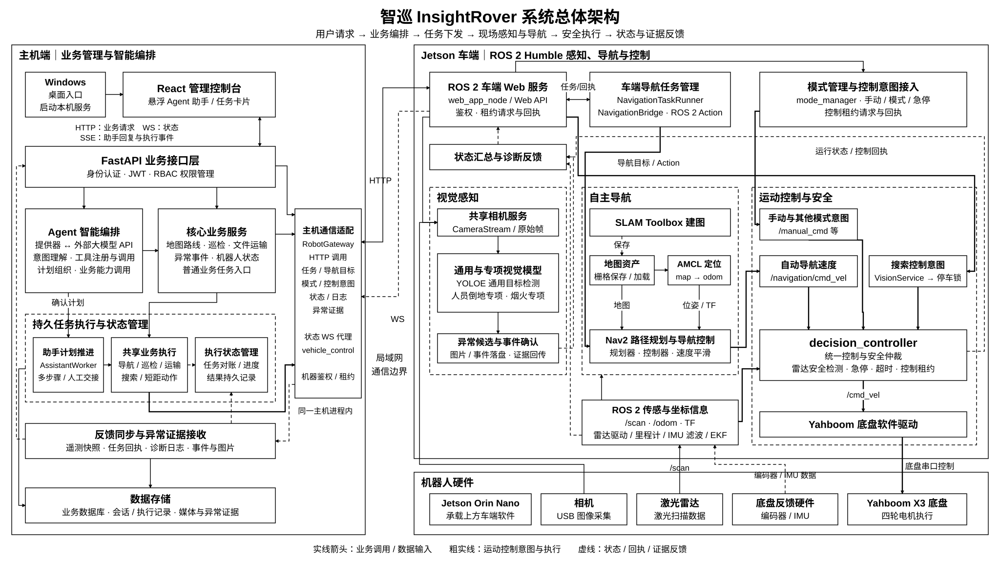

# InsightRover 智巡系统

基于 ROS 2 的移动机器人感知、控制与巡检管理平台。

InsightRover 面向 Yahboom ROSMASTER X3 麦克纳姆轮底盘和 Jetson 计算平台，将 ROS 2 车端、FastAPI 业务后端、React 控制台及 Windows 桌面入口集成到同一套工程中，支持遥控、视觉感知、地图管理、任务管理和自然语言助手。

当前源码以 V4 开发线为基础，Windows 桌面组件版本为 **4.0.2**。前端、业务 API 与桌面组件分别维护版本字段；仓库版本不表示全部硬件能力已通过现场验收。

## 目录

- [系统功能](#系统功能)
- [系统架构](#系统架构)
- [工程结构](#工程结构)
- [环境要求](#环境要求)
- [本地开发](#本地开发)
- [车端部署](#车端部署)
- [模型与数据](#模型与数据)
- [验证与运行边界](#验证与运行边界)
- [开发检查](#开发检查)
- [技术文档](#技术文档)
- [第三方组件与许可](#第三方组件与许可)

## 系统功能

| 模块 | 主要内容 |
| --- | --- |
| 车辆控制 | 手动遥控、模式切换、速度设置、急停、命令超时停车及控制租约 |
| 雷达与避障 | 激光点云、障碍距离、雷达健康状态、主动避障设置及运行状态 |
| 视觉感知 | 共享视频流、YOLOE 开放词汇目标搜索、YOLO11 人物检测与 ByteTrack 跟踪、HSV 颜色追踪 |
| 安全事件 | 烟火与人员倒地专项模型接入、持续确认、事件图片留存、后台入库与通知 |
| 地图管理 | SLAM 会话、栅格地图保存与加载、地点管理、上传平面图及四点标定 |
| 任务管理 | 导航、巡检、运输和目标搜索的任务记录、状态同步与执行接口 |
| Agent 助手 | 流式对话、持久会话、结构化计划、受限工具调用、任务执行、系统诊断与报告 |
| 运维管理 | 登录认证、角色权限、审计、健康状态、跨端诊断日志及能力验收登记 |
| Windows 桌面入口 | 本机服务管理、SSH 连接、车端启动、Wi-Fi 切换及独立用户数据目录 |

以上为工程实现范围。任务是否允许执行，由当前车辆状态、权限、车端协议和对应能力验收共同决定。

## 系统架构



架构图采用黑白横向分区，分别表达主机业务与 Agent 编排、持久任务执行、主机通信适配、Jetson 感知导航与统一安全控制，以及机器人硬件。HTTP、状态 WebSocket、助手 SSE 和 ROS 2 内部通信按各自职责标明。

图稿下载：[SVG 矢量图](docs/architecture/insightrover-system-architecture.svg) · [高清 PNG（7680 × 4320）](docs/architecture/insightrover-system-architecture.png) · [Draw.io 可编辑源文件](docs/architecture/insightrover-system-architecture.drawio) · [Mermaid 源文件](docs/patrol-assistant-architecture.mmd)。[修改说明与代码核查](docs/architecture/README.md)。

主机与 Agent 通过受控接口表达操作意图，车辆网关不直接发布 `/cmd_vel`。车端控制器统一处理模式、急停、传感器时效、控制权和速度约束。模型不能通过自由文本执行任意 Shell、HTTP 请求或 ROS 话题发布。

## 工程结构

```text
ros2-smart-car/
├── backend/                 # FastAPI、数据库、认证、任务执行与 Agent
├── web-console/             # React / TypeScript / Vite 控制台
├── desktop/                 # Windows 启动入口、代理和打包工具
├── ros2_ws/src/
│   └── smart_car_decision/  # ROS 2 节点、控制逻辑、配置及模型资源
├── robot-gateway/           # 网关说明
├── scripts/                 # 构建、部署、诊断与验证工具
├── tests/                   # 车端逻辑和接口的离线测试
├── evaluation/              # 助手评估样例
├── training/                # 专项模型训练资料
├── maps/                    # 地图资源说明
├── docs/                    # 架构、接口、部署和验证文档
├── doc/                     # 感知与安全巡检等专题说明
├── releases/                # 已纳入版本管理的历史交付资料
└── src/                     # STM32 等底层工程资料
```

当前控制台入口为 `web-console/`。子目录中的早期 README 和交付记录可能对应历史版本，使用时应核对其版本与日期。

## 环境要求

| 运行位置 | 环境与依赖 |
| --- | --- |
| 本机业务后端 | Python 3、`backend/requirements.txt` 中的依赖；默认使用 SQLite |
| Web 开发 | Node.js、npm；通过锁文件安装前端依赖 |
| Windows 桌面端 | Windows 10 / 11 x64；源码构建另需 PyInstaller，安装器构建需 Inno Setup |
| 机器人车端 | Ubuntu、ROS 2 Humble、colcon、Yahboom 底盘与雷达驱动、OpenCV 及视觉推理依赖 |
| 视觉硬件 | USB 相机、激光雷达；GPU 推理环境须与目标 Jetson 的系统版本匹配 |

厂商底盘与雷达驱动需单独准备。本项目的自研部分主要位于决策控制、视觉服务、业务管理、助手和诊断模块。

## 本地开发

### 获取源码

```bash
git clone https://github.com/xbai55/ros2-smart-car.git
cd ros2-smart-car
```

### 启动业务后端

建议使用独立 Python 虚拟环境。在仓库根目录安装依赖：

```bash
python -m pip install -r backend/requirements.txt
cd backend
python -m app.seed
python -m uvicorn app.main:app --host 127.0.0.1 --port 8000
```

初始化命令创建角色、权限、用户及基础设置。开发账户包括 `admin/admin123`、`operator/operator123` 和 `auditor/auditor123`；仅供本地开发，实际部署应修改密码和 `JWT_SECRET`。

- 业务服务：`http://127.0.0.1:8000`
- API 文档：`http://127.0.0.1:8000/docs`

### 启动 Web 控制台

在另一个终端中，从仓库根目录执行：

```bash
cd web-console
npm ci
npm run dev
```

访问 `http://127.0.0.1:5173`。开发代理默认连接本机 `8000` 端口的业务后端；可使用 `BUSINESS_PROXY_TARGET` 调整代理目标。

本地页面和业务服务可独立运行。实时遥测、视频与运动任务需要已部署且可连接的车端服务；离线业务记录不代表实际车辆已经执行任务。

### 配置车辆与助手

下列变量应在启动业务服务前设置：

| 配置项 | 用途 |
| --- | --- |
| `DATABASE_URL` | 业务数据库连接；默认 `sqlite:///./smart_patrol.db` |
| `JWT_SECRET` | 登录令牌签名密钥 |
| `ROBOT_WEB_URL` / `ROBOT_GATEWAY_URL` | 车辆服务连接地址，具体路由见后端文档 |
| `ROBOT_SERVICE_TOKEN` | 主机与车端共享的机器鉴权凭据 |
| `STORAGE_LOCAL_DIR` | 本地媒体与证据文件存储目录 |
| `ASSISTANT_BASE_URL` / `ASSISTANT_MODEL` / `ASSISTANT_API_KEY` | 助手模型服务配置 |
| `ASSISTANT_VISION_BASE_URL` / `ASSISTANT_VISION_MODEL` / `ASSISTANT_VISION_API_KEY` | 可选的独立视觉模型服务 |

助手配置示例见 [backend/assistant.env.example](backend/assistant.env.example)。示例文件用于说明配置字段，不会因复制文件而自动配置全部启动方式。独立业务服务通过运行环境提供配置，Windows 桌面版也支持原生配置入口；未配置图像能力时，不假定对话模型能够看图。

数据库、地图、媒体和连接配置应单独备份。Windows 桌面版用户数据默认位于 `%LOCALAPPDATA%\InsightRover`，程序文件默认位于 `%LOCALAPPDATA%\Programs\InsightRover`。

## 车端部署

在已安装 ROS 2 Humble 和厂商驱动的目标设备上，可使用基础构建入口：

```bash
bash scripts/build_jetson.sh
```

V4 部署还需配置机器凭据、控制租约、共享视觉服务、模型路径、设备参数及独立服务目录。部署步骤见 [车端部署说明](docs/v4-vehicle-deployment.md)，相关工具包括 `scripts/stage_v4_vehicle.py`、`scripts/provision_v4_vehicle.py` 和 `scripts/preflight_v4_vehicle.py`。执行前应查看各脚本参数，按目标设备调整配置。

`scripts/run_jetson.sh` 提供基础启动入口，默认 `ROS_DOMAIN_ID=77`。使用共享视觉服务时，按部署文档关闭独立旧相机推理进程，避免重复占用摄像头。

桌面安装包负责连接兼容的车端服务，不会自动将本仓库源码部署到任意小车。更新车端后，应核对实际源码构建、设备配置和控制发布者，再进行静止检查及逐项现场验收。

## 模型与数据

通用视觉搜索采用 YOLOE 相关模型；人物跟随使用 YOLO11 与 ByteTrack。多数推理权重、训练数据及本地生成资源不随源码分发，应按实际配置单独准备。

仓库已包含固定版本的 `yolo11-fall.pt` 倒地专项权重，其摘要、类别映射和获取方式见 [倒地模型接入说明](docs/fall-model-integration.md)。其中 `fallen` 表示倒地或躺卧姿态，单帧结果不能证明发生了跌倒动作，也不能区分主动躺下与异常倒地。烟火专项权重需要另行配置。

地图、媒体证据、模型文件与数据库之间存在引用关系，备份时应一并保存对应资源。密钥、个人数据库、运行日志和机器配置不应提交到仓库。

## 验证与运行边界

4.0.2 部署记录确认了车端服务构建、停车状态、视觉模型运行和部分接口连通性，详见 [Agent 系统工具记录](docs/agent-system-tools.md)。这些记录对应当时的部署环境，不替代当前设备的状态检查。

| 能力 | 当前验证边界 |
| --- | --- |
| 认证、任务、诊断与助手接口 | 已有离线回归及隔离环境验证记录 |
| 视觉模型运行与事件链路 | 已有静止运行检查；烟火与倒地的准确率需单独现场评估 |
| 受限短距前进 | 已实现里程计反馈、限速、超时与停车；完整能力须按对应构建验收 |
| SLAM 建图 | 已实现会话、记录和地图接口；本次纳入回调锁竞争修复，完整移动建图仍待验证 |
| 导航、巡检、运输与移动搜索 | 已提供任务及执行链路，需分别完成当前版本的现场验收 |
| 长时间运行与异常恢复 | 需继续验证磁盘空间、日志写入、传感器时效和失联工况 |

软件测试通过、部署成功和实车验收是不同结论。能力放行按车辆、构建、地图及视觉模型指纹核验；相关资源变化后，需要重新检查验收是否仍然有效。

## 开发检查

在仓库根目录运行车端离线测试：

```bash
python -m pytest tests -q
```

在 `backend/` 目录运行后端与桌面测试：

```bash
python -m pytest tests ../desktop/tests -q
```

在 `web-console/` 目录运行前端测试与构建：

```bash
npm test
npm run build
```

上述检查主要验证逻辑、接口和构建，不会完成物理车辆的导航、避障或识别效果验收。执行带有 `vehicle`、`live` 或 `deploy` 等名称的现场工具前，应确认工具行为及目标设备。

## 技术文档

| 主题 | 文档 |
| --- | --- |
| 系统总体架构图 | [图稿、源文件与修改说明](docs/architecture/README.md) |
| 业务后端与接口 | [Backend](backend/README.md) |
| 车端 Web API | [车辆接口](docs/vehicle-web-api.md) |
| Agent 控制与短距前进 | [任务控制](docs/v4-agent-control.md) |
| Agent 诊断、视觉与恢复工具 | [系统工具](docs/agent-system-tools.md) |
| 助手 API | [接口说明](docs/v4-assistant-api.md) |
| 控制权与安全边界 | [控制租约](docs/v4-control-lease.md)、[控制边界](docs/v4-control-boundary.md) |
| 运行诊断 | [诊断系统](docs/v4-diagnostics.md) |
| 实车能力验收 | [验收登记](docs/v4-physical-acceptance.md) |
| 模型集成 | [倒地专项模型](docs/fall-model-integration.md) |
| 主动避障 | [设计与参数](docs/active-avoidance.md) |
| 地图与建图记录 | [地图管理](docs/map-management.md)、[建图设置与记录](docs/mapping-settings-and-recordings.md) |
| V4 历史验证 | [合并与部署记录](docs/agent-system-tools-validation-20261111.md) |
| Windows 桌面入口 | [使用与构建](desktop/README.md) |

## 第三方组件与许可

本项目使用 ROS 2、Yahboom 驱动、Ultralytics、FastAPI、React 等第三方组件。厂商驱动、模型权重、数据集及打包运行库遵循各自的许可和使用条件，桌面依赖声明见 [THIRD_PARTY_NOTICES.txt](desktop/THIRD_PARTY_NOTICES.txt)。

仓库当前未提供覆盖全部自研源码的统一开源许可证。第三方组件的许可证不构成对本项目其他代码或模型的统一授权；再分发或商业使用前应分别核对。
