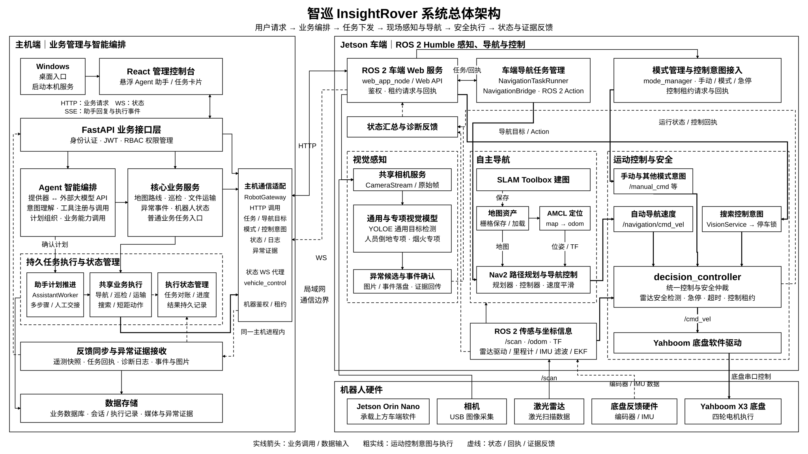

# 系统总体架构图

本图用于《智巡 InsightRover 智能巡检机器人系统综合设计报告》和项目答辩 PPT。图中保留黑白线框、文字模块和箭头表达，采用 16:9 横向画布。

## 文件

| 文件 | 用途 |
| --- | --- |
| [SVG 矢量图](insightrover-system-architecture.svg) | 插入 Word 与 PPT，缩放后仍保持清晰；文字与线条可编辑 |
| [高清 PNG](insightrover-system-architecture.png) | 7680 × 4320，适用于需要位图的排版软件 |
| [Draw.io 源文件](insightrover-system-architecture.drawio) | 在 diagrams.net 或 Draw.io 中编辑模块、文字与连接线 |
| [Mermaid 源文件](../patrol-assistant-architecture.mmd) | 基于既有源图更新的完整总体关系图，可直接渲染 |
| [代码核查说明](source-audit.md) | 模块和核心连线的源码依据 |

SVG、Draw.io 与 PNG 使用同一份布局数据。Mermaid 保持相同的模块与连接关系，自动布局由渲染器决定；报告与答辩使用经过人工检查的 SVG 或 PNG。

## 修改说明

- 将原有纵向调用链整理为主机业务、主机通信适配、Jetson 软件和机器人硬件区域；通信适配仍位于主机边界内。
- 区分 Agent 意图理解与计划组织、助手计划推进、共享业务执行和任务状态对账，展示普通业务任务与助手任务复用执行入口的关系。
- 分别标明前后端 HTTP、状态 WebSocket、助手 SSE，以及车端内部 ROS 2 Topic、Action 与 TF；区分 RobotGateway 的 HTTP 调用和后端状态 WS 代理。
- 分开表达 SLAM Toolbox、地图资产、AMCL 和 Nav2，明确地图与定位信息流向；将 Nav2 速度、手动意图和搜索控制汇入统一安全控制器。
- 将底盘软件驱动与电机硬件分开，将激光扫描、里程计和 TF 放入软件信息层；用虚线表示状态、回执及证据反馈，减少数据库连线。

## 文件检查

Mermaid 11.12.1 解析通过；SVG 与 Draw.io XML 解析通过；模块文字边界、折线方向、节点遮挡及本地文档链接检查通过。最终 PNG 经全图及局部检查，确认中文完整、黑白显示、模块无重叠，画布尺寸为 16:9。

重建：在仓库根目录执行 `python docs/architecture/build_architecture.py`，再在安装 `sharp` 的 Node.js 环境执行 `node docs/architecture/render_architecture.cjs`。渲染脚本输出高清 PNG 和预览图，不调用外部图像生成服务。
